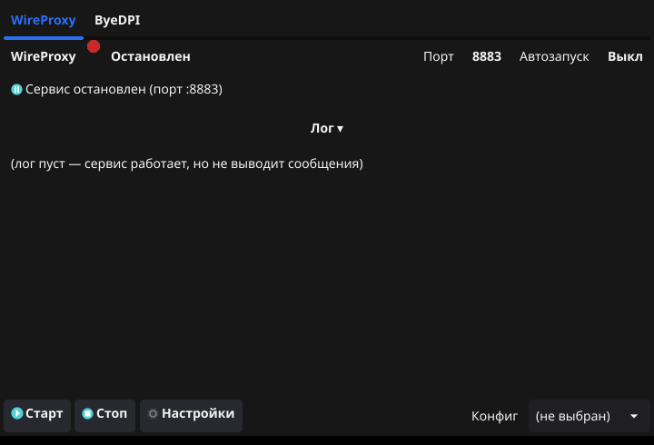

# ProxyControl

A lightweight GUI manager for [WireProxy](https://github.com/pufferffish/wireproxy) and [ByeDPI](https://github.com/hufrea/byedpi) proxy services, built with [Go](https://go.dev/) + [Fyne](https://fyne.io/).

Single binary, no runtime dependencies on Python/Node/Electron. Controls systemd user services, tails logs, checks connectivity, and manages config — all from a tabbed window.

## Features

- **Tabbed UI** — switch between WireProxy and ByeDPI at the top of the window (the thing YAD couldn't do).
- **Per-service status** — live indicator (🟢 running / 🔴 stopped), port, autostart state.
- **Log viewer** — tails `journalctl --user -u <service>` (or the log file if the unit appends to one), auto-scrolling, refreshed every 3 s.
- **Control buttons** — Start / Restart / Stop / Settings, in a horizontal row.
- **Network check** — verifies SOCKS5 connectivity by running `curl --socks5-hostname` through the service port every 10 s.
- **Binary installer** — if a binary is missing, the tab shows install buttons: pick a local file or download the latest release from GitHub (configurable fork) and install to `~/.local/bin` or `/usr/local/bin` (with `pkexec`/`sudo`).
- **Update checker** — optional startup check compares each installed binary's version against the latest GitHub release; shows a dialog with one-click download for out-of-date binaries.
- **Settings dialog** — autostart checkboxes, port entries (1–65535, validated), fork-slug fields (point at a different GitHub fork), update-check toggle, and "open folder" buttons.
- **Persistent state** — remembers the last-opened tab, port settings, binary paths, forks, and update-check preference across restarts.

## Screenshots



## Prerequisites

### Runtime (on the target machine)

- Linux desktop with X11 or Wayland
- `systemctl --user` (systemd user session)
- `curl` (for network connectivity checks)
- `xdg-open` (for "open folder" buttons)
- `dbus-monitor` (for the wake-from-sleep resume monitor; optional)
- WireProxy and/or ByeDPI binaries — **no longer a hard prerequisite**.
  If a binary is missing, its tab shows install buttons (see
  [Binary installation](#binary-installation) below).

### Build (on the development machine)

#### 1. Go toolchain (≥ 1.23)

```bash
# Option A: official tarball (no root needed)
curl -sL https://go.dev/dl/go1.23.4.linux-amd64.tar.gz | tar -C /usr/local -xz
export PATH="/usr/local/go/bin:$PATH"

# Option B: package manager (Debian/Ubuntu)
sudo apt install golang-go
```

Verify:

```bash
go version  # should print go1.23.x
```

#### 2. CGO build dependencies

Fyne uses GLFW + OpenGL via CGO, so you need a C compiler and the X11/GL development headers:

**Debian / Ubuntu:**

```bash
sudo apt install -y \
    gcc pkg-config \
    libx11-dev libxext-dev libxfixes-dev libxi-dev \
    libxrandr-dev libxinerama-dev libxcursor-dev libxxf86vm-dev \
    libgl-dev libegl-dev libgles-dev libglvnd-dev libglx-dev \
    libxkbcommon-dev libxkbcommon-x11-dev \
    libwayland-dev
```

**Fedora / RHEL:**

```bash
sudo dnf install -y \
    gcc pkg-config \
    libX11-devel libXext-devel libXfixes-devel libXi-devel \
    libXrandr-devel libXinerama-devel libXcursor-devel libXxf86vm-devel \
    mesa-libGL-devel mesa-libEGL-devel mesa-libGLES-devel \
    libxkbcommon-devel libxkbcommon-x11-devel \
    wayland-devel
```

**Arch Linux:**

```bash
sudo pacman -S --needed \
    base-devel pkgconf \
    libx11 libxext libxfixes libxi libxrandr libxinerama libxcursor libxxf86vm \
    mesa glu libegl libgles \
    libxkbcommon libxkbcommon-x11 wayland
```

Verify the GL and X11 pkg-config packages are found:

```bash
pkg-config --exists gl x11 xrandr xinerama xcursor xi xxf86vm xext && echo "All OK"
```

## Build

```bash
cd proxycontrol
go build -o proxycontrol .
```

This produces a single `proxycontrol` binary (~30 MB, dynamically linked to system GL/X11 libraries).

### Cross-compilation

Fyne requires CGO, so cross-compiling requires a C cross-toolchain. For same-architecture builds:

```bash
CGO_ENABLED=1 go build -o proxycontrol .
```

### Stripping the binary (optional, for smaller size)

```bash
go build -ldflags="-s -w" -o proxycontrol .
# Reduces size from ~30 MB to ~22 MB
```

## Install

Copy the binary to somewhere in your `$PATH`:

```bash
cp proxycontrol ~/.local/bin/
```

Or install directly:

```bash
go install ./...
```

## Usage

```bash
proxycontrol
```

The app reads and writes to `~/.config/proxycontrol/`:

```
~/.config/proxycontrol/
├── proxycontrol.conf          # JSON: {"wp_port": 8883, "bd_port": 8882}
├── .last_tab                  # "wireproxy" or "byedpi"
├── wireproxy/
│   ├── wireproxy.conf         # active WireProxy config
│   ├── wireproxy.template     # template (BindAddress is rewritten on port change)
│   └── wireproxy.log          # log file (if the unit uses StandardOutput=append:)
└── byedpi/
    ├── byedpi.txt             # active ByeDPI config
    ├── .port                  # port file (read by the systemd unit)
    └── byedpi.log             # log file
```

### Expected systemd user units

The app expects these user services to exist:

**`~/.config/systemd/user/wireproxy.service`:**
```ini
[Unit]
Description=WireProxy SOCKS5 tunnel

[Service]
ExecStart=/usr/local/bin/wireproxy -c %h/.config/proxycontrol/wireproxy/wireproxy.conf
Restart=on-failure

[Install]
WantedBy=default.target
```

**`~/.config/systemd/user/byedpi.service`:**
```ini
[Unit]
Description=ByeDPI SOCKS5 proxy

[Service]
ExecStart=/bin/bash -c '/usr/local/bin/byedpi -i 127.0.0.1 -p $(cat %h/.config/proxycontrol/byedpi/.port 2>/dev/null || echo 8882)'
Restart=on-failure

[Install]
WantedBy=default.target
```

After creating the units:

```bash
systemctl --user daemon-reload
```

### Port changes

When you change a port in Settings and click Apply:

- **WireProxy**: the `BindAddress = 127.0.0.1:<port>` line is rewritten in both `wireproxy.template` and `wireproxy.conf`, then the service is restarted if it was running.
- **ByeDPI**: the `.port` file is updated, then the service is restarted if it was running.

### Autostart

The Settings dialog checkboxes enable/disable the systemd user units (`systemctl --user enable/disable`). This controls whether the proxy starts automatically on login.

### Binary installation

Each tab reads its binary path from the config file (`wp_path` / `bd_path`,
defaulting to `/usr/local/bin/wireproxy` and `/usr/local/bin/byedpi`).  If the
configured path is empty or the file does not exist there, the tab hides the
status panel, log and control buttons and shows two buttons instead:

- **📁 Выбрать файл** — opens a file picker.  Pick an existing binary on disk
  and its path is saved to the config.  No copying is done; the file stays
  where it is.
- **⬇ Скачать с GitHub** — fetches the latest release from the configured
  fork, downloads the `.tar.gz` matching your architecture, and extracts the
  binary.  You then choose where to install it:
  - **`~/.local/bin`** — your user bin directory (no privileges needed).
  - **`/usr/local/bin`** — system-wide.  This uses `pkexec` (or `sudo` as a
    fallback) to copy the file as root, so you will get a password prompt.

After a successful install the path is saved to the config, the systemd unit's
`ExecStart` is updated to point at the new binary (only if the unit was
generated by ProxyControl — hand-written units are left alone), and the tab
switches to the normal status/controls view.

#### Forks

The Settings dialog has a **Форк WireProxy (GitHub)** and a **Форк ByeDPI
(GitHub)** field where you can enter any `owner/repo` slug to download from
a different fork.  Defaults:

| Service  | Default fork |
| -------- | ------------ |
| WireProxy | [`artem-russkikh/wireproxy-awg`](https://github.com/artem-russkikh/wireproxy-awg) (AWG fork — adds AmneziaWG support) |
| ByeDPI    | [`hufrea/byedpi`](https://github.com/hufrea/byedpi) |

> ByeDPI's release archive contains the binary as `ciadpi-<arch>` (the C
> implementation is called ciadpi); ProxyControl handles this automatically
> and installs it as `byedpi`.

#### Update checking

The Settings dialog has an **Обновления** checkbox: *«проверять обновления
бинарных файлов при запуске»*.  When enabled, ProxyControl checks each
installed binary's `--version` output against the latest GitHub release tag
on startup.  If a newer version is available, a dialog lists the services
with their current → latest versions and a **Скачать** button for each —
clicking it downloads the new release and installs it over the existing
binary (using `pkexec`/`sudo` if the binary is in `/usr/local/bin`).

Version comparison normalises leading zeros, so a tag like `v0.17.3`
matches a binary reporting `17.3` (no false "update available" for ByeDPI).

> The GitHub API allows 60 unauthenticated requests per hour per IP.  If you
> hit that limit, set the `GITHUB_TOKEN` environment variable to a personal
> access token (no scopes needed) to raise it to 5000/hour.

## Project structure

```
proxycontrol/
├── go.mod          # module definition (github.com/poiNt3D/ProxyControl)
├── main.go         # app entry, window, tabs, settings callback, --test-install mode
├── config.go       # JSON config load/save (ports, binary paths), last-tab persistence
├── service.go      # service definitions, systemd wrappers, binary-path checks, log reading
├── systemd.go      # auto-create systemd user units + wake-from-sleep resume monitor
├── installer.go    # GitHub release download, extract, install (user bin / system-wide w/ sudo)
├── network.go      # SOCKS5 connectivity checker (curl)
├── tab.go          # per-service tab UI (normal ↔ install mode, status, log, buttons)
├── settings.go     # settings dialog (checkboxes, port entries, folder buttons)
├── .gitignore
└── README.md
```

## License

MIT
